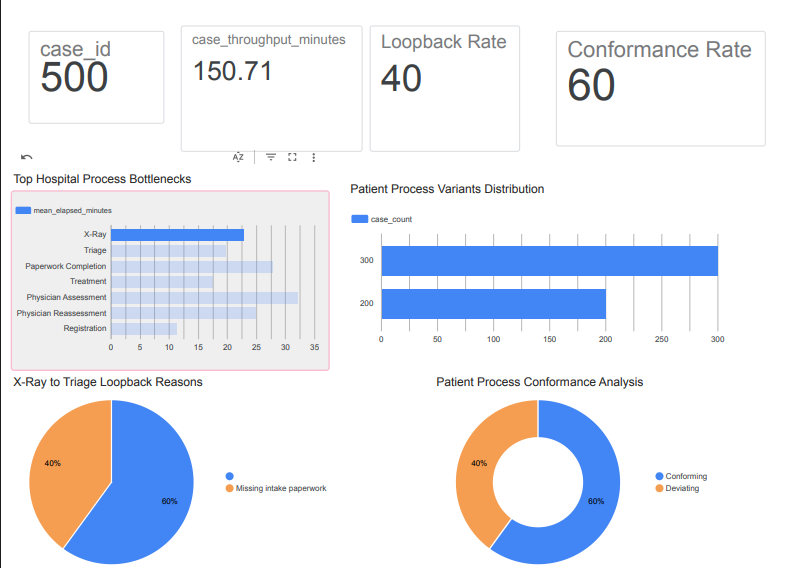

# CareFlow — Clinical Pathway Process Mining

> Reconstruct what patients *actually* experience in the Emergency Room — not just the average wait time — and find the hidden loops that drive delays.

     

**Domain:** Healthcare operations & process analytics

---

## 1. Problem

Standard BI dashboards report an *average wait time* but cannot show the real, chaotic sequence of events a patient goes through. CareFlow ingests timestamped EHR-style event logs (`Case_ID`, `Activity_Name`, `Timestamp`), uses process-mining algorithms to build a "spaghetti diagram" of actual patient flows, and highlights operational bottlenecks.

**Headline finding (synthetic scenario):** 40% of patients are sent back from X-Ray to Triage because of a missing paperwork step. Those cases take ~53 minutes longer (182.7 vs 129.4 min); removing the loop would cut the average case time by about **21 minutes**, in line with the project brief's ~20-minute target.

> ⚠️ **Synthetic-data notice.** Every record is generated for software testing. The 40% loop is deliberately injected. Results demonstrate the workflow; they are not statistics about a real hospital and not evidence that any intervention works.

## 2. Architecture

```
Python generator ──► raw_event_log.csv ──► BigQuery (raw) ──► dbt (staging → intermediate → marts)
                                                  │                          │
                                         PM4Py discovery  ◄──────────────────┘
                                                  │
                         bottlenecks · variants · conformance ──► Dashboard (HTML / Power BI / Looker)
```

| Layer | Technology | Where |
|---|---|---|
| Event-log generation | Python / pandas (seeded, reproducible) | notebook §3 |
| Warehouse | Google BigQuery | `scripts/load_synthetic_to_bigquery.py` |
| Normalization | dbt | `careflow_dbt/` |
| Process mining | PM4Py (DFG, inductive Petri net, alignments) | `scripts/run_pm4py_*.py` |
| Bottlenecks | pandas + dbt SQL | `scripts/week3_bottleneck_metrics.py` |
| Conformance | exact-sequence baseline + PM4Py alignments | `scripts/week4_conformance.py`, `scripts/run_pm4py_conformance.py` |
| Dashboard | Looker Studio report + self-contained HTML process-map dashboard | `docs/images/looker_studio_report.png`, `dashboard/`, `docs/POWERBI_LOOKER_GUIDE.md` |
| BI-ready tables | Labelled CSVs for Looker/Power BI | `scripts/export_bi_datasets.py` → `careflow_data/bi_ready/` |

## 3. Features (by project week)

| Week | Deliverable | Status |
|---|---|---|
| 1 | Synthetic EHR event-log generator with injected loop-backs; BigQuery loader; dbt project scaffold | ✅ Built (cloud load needs your GCP project) |
| 2 | Event normalization (dbt staging/intermediate), data-quality audit, PM4Py discovery of the as-is map | ✅ Built and run locally |
| Mid-review | Pipeline audit: validated, chronological event log; directed graph of major paths | ✅ `scripts/audit_event_log.py` |
| 3 | Transition-time bottleneck metrics (mean / median / P90), case duration, loopback flags, shift summary | ✅ SQL (dbt) and Python |
| 4 | Conformance checking vs. the ideal pathway; drill-down by age band, shift, department, resource | ✅ Exact-match + PM4Py alignments |
| Final | Dashboard with process map, bottlenecks, variants, filters and what-if | ✅ Looker Studio report (screenshot included), HTML dashboard, Power BI/Looker guide |

## 4. Repository structure

```text
CareFlow_Project/
├── CareFlow_Clinical_Pathway_ProcessMining.ipynb   # End-to-end analysis (generation → insights)
├── run_all.sh                                       # Reproduce every artifact + run tests
├── requirements.txt / requirements-cloud.txt
├── scripts/
│   ├── careflow_analysis.py             # Shared validation, transition-time and loop-back helpers
│   ├── audit_event_log.py               # Data-quality audit
│   ├── run_pm4py_discovery.py           # DFG, variants, inductive Petri net (PNML)
│   ├── week3_bottleneck_metrics.py      # Transition times, case metrics, shift summary
│   ├── week4_conformance.py             # Exact-sequence conformance + cohort drill-downs
│   ├── run_pm4py_conformance.py         # PM4Py alignment-based conformance
│   ├── export_bi_datasets.py            # Labelled BI tables for Looker / Power BI
│   ├── build_dashboard.py               # Generates the interactive dashboard
│   └── load_synthetic_to_bigquery.py    # Guarded BigQuery loader (synthetic only)
├── careflow_dbt/                        # dbt models, schema tests, singular SQL tests
├── careflow_data/                       # Event logs and all generated outputs
│   ├── process_discovery/  week3_metrics/  week4_outputs/  pm4py_conformance/  bi_ready/  python_helpers/
├── dashboard/careflow_dashboard.html    # Open directly in a browser
├── pyproject.toml                       # pytest + coverage configuration (80% gate)
├── docs/                                # Warehouse guide, Looker/Power BI guide, ISSUES_FIXED.md, weekly reports, images/
└── tests/                               # 41 automated tests (88% script coverage)
```

## 5. Quick start

```bash
python -m venv .venv && source .venv/bin/activate     # Windows: .venv\Scripts\Activate.ps1
pip install -r requirements.txt
bash run_all.sh                                       # audit → discovery → metrics → conformance → BI tables → dashboard → loader dry-run → tests
```

Then open `dashboard/careflow_dashboard.html` in any browser, or explore the notebook:

```bash
jupyter lab CareFlow_Clinical_Pathway_ProcessMining.ipynb
```

Individual steps:

```bash
python scripts/run_pm4py_discovery.py --require-pm4py
python scripts/week3_bottleneck_metrics.py --input careflow_data/clean_event_log.csv --output-dir careflow_data/week3_metrics
python scripts/week4_conformance.py --input careflow_data/clean_event_log.csv --output-dir careflow_data/week4_outputs
python scripts/run_pm4py_conformance.py
python scripts/export_bi_datasets.py
python scripts/load_synthetic_to_bigquery.py --dry-run    # no cloud access needed
python -m pytest --cov=scripts -q
```

## 6. BigQuery + dbt

```bash
pip install -r requirements-cloud.txt
export GCP_PROJECT_ID=your-project
python scripts/load_synthetic_to_bigquery.py --dataset careflow_raw --table raw_event_log
cp careflow_dbt/profiles.yml.example ~/.dbt/profiles.yml     # edit project / auth
cd careflow_dbt && dbt debug && dbt run && dbt test
```

Use `--dry-run` first to validate the file without any cloud access. The loader refuses any row not flagged `Is_Synthetic=True` and **truncates** the target table, so use a dedicated demo table. Marts: `fct_patient_cases`, `fct_transition_bottlenecks`, `fct_triage_loopbacks`, `fct_process_variants`, `fct_conformance_results`. Full guide: [`docs/WAREHOUSE_AND_PROCESS_MINING.md`](docs/WAREHOUSE_AND_PROCESS_MINING.md).

> **Not verified here:** the BigQuery load and `dbt run/test` were not executed against a real GCP project (no credentials). Run them in your environment before relying on them.

## 7. Key results (synthetic data)

| Metric | Value |
|---|---|
| Cases / events | 500 / 3,900 |
| Process variants | 2 |
| X-Ray → Triage loopback rate | 40.0% (200 cases) |
| Baseline conformance | 60.0% (300 cases) |
| Mean case time | 150.7 min (looped 182.7 vs. clean 129.4) |
| Largest single gap | Physician Assessment → X-Ray, 32.1 min mean |
| Loop-related gaps | X-Ray → Triage 30.9, Paperwork → Reassessment 27.9, Triage → Paperwork 12.4 |
| PM4Py alignment fitness vs. baseline | 0.95 mean (looped traces cost 2 extra moves) |

## 8. Event-log schema

| Field | Meaning |
|---|---|
| `Case_ID` | Anonymous visit identifier |
| `Activity_Name` | Activity (Triage, X-Ray, …) |
| `Timestamp` | Event time |
| `Department`, `Resource_ID`, `Age_Band`, `Arrival_Shift` | Drill-down attributes |
| `Return_Reason`, `Rework_Expected` | Marks the injected loop |
| `Is_Synthetic` | Always `True` in this repo |

## 9. Metric definitions & caveats

- **Case throughput** = last event − first event per case.
- **Elapsed time between events** = next timestamp − current timestamp. Without queue-entry/start/end stamps this is *not* pure waiting or service time.
- **Baseline conformance** = exact match to `Registration → Triage → Physician Assessment → X-Ray → Physician Reassessment → Treatment → Discharge`. This is a prototype rule; valid clinical variants must be agreed with process owners.
- **What-if saving** compares looped vs. non-looped synthetic cases; it is not a causal estimate.

## 10. Responsible use

Never commit real patient data, credentials or service-account keys. Real EHR data requires authorization, de-identification, and the organization's privacy, security, access and retention controls.

## 11. Remaining work for production

1. Run and validate BigQuery + dbt in an authorized GCP project.
2. Build the Power BI/Looker report using [`docs/POWERBI_LOOKER_GUIDE.md`](docs/POWERBI_LOOKER_GUIDE.md) (a `.pbix` must be authored in Power BI Desktop).
3. Agree clinical reference pathways and permitted variants before using deviation rates as quality measures.
4. Replace synthetic data with approved, de-identified data and validate before/after impact of any intake-form change.

## 12. Dashboard preview

Looker Studio report (500 cases · 150.71 min · 40% loopback · 60% conformance):



Suggested chart fixes are in [`docs/POWERBI_LOOKER_GUIDE.md`](docs/POWERBI_LOOKER_GUIDE.md#6-existing-looker-studio-report--review-and-fixes).

## 13. Project history

Weekly reports and commit plans are in [`docs/reports/`](docs/reports/). Review fixes made to the GitHub branch are listed in [`docs/ISSUES_FIXED.md`](docs/ISSUES_FIXED.md).
